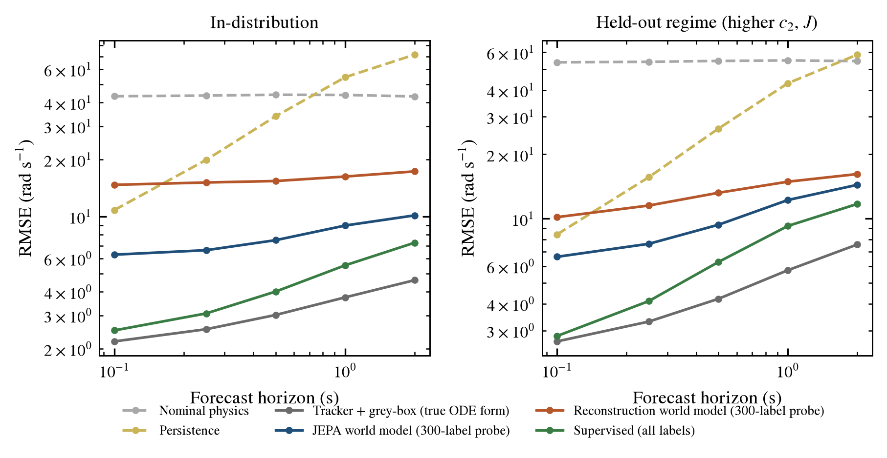

# Euler-JEPA v2 — an action-conditioned latent world model for a rotor you can only hear

v2 is a redesign of the Euler-JEPA mini study. The v1 code, results and paper in the
parent folder are unchanged; v2 is additive and its numbers are **not comparable** with v1,
because the benchmark asks a different and harder question.

## Why v1 could not show what JEPA is for

The v1 audit (parent `reports/main.tex`) was honest, and its negative result was structural:

| v1 design choice | Consequence |
| --- | --- |
| Rotor speed observed directly and noise-free | Nothing for representation learning to do; supervised regression on the scored quantity must win. |
| JEPA latent prediction was an auxiliary term (weight 0.05); the forecast came from a separate head on the context embedding | The JEPA objective could not improve the forecast by construction; it could only regularise or harm the shared encoder. |
| Control held constant within every sequence | The control derivative is not identifiable from the data, so every learned model was control-insensitive. Perturbing *u* alone at test time was an off-manifold input. |
| Full-trajectory protocol: $k_\omega = 0.25$, $\omega_0\approx400$ rad/s | Equilibrium speed is about 21 rad/s, so every sequence was a spin-down far from any operating point. |
| 96 training sequences, single latent summary, effective rank about 1 of 24 | Collapse-prone and data-starved. |

## What v2 does instead

**Benchmark (synthetic, declared).** The same Euler-work rotor balance, now with a
lagged and delayed actuator, hidden per-episode parameters, and time-varying commands:

$$
J\,\dot\omega = \dot m\,r\,(k_u a - k_\omega\omega) - c_0 - c_2\omega^2,\qquad
\tau_a\,\dot a = u(t-d\,\Delta t) - a .
$$

$\dot m, J, k_\omega, c_2, \tau_a, d$ are drawn per episode and never shown to the models.
Operating points are consistent: the equilibrium speeds lie between about 130 and 740 rad/s, and
$1/\beta$ ranges from 0.5 to 1 s.

**Partial observation.** Models never see $\omega$. They receive a 64-bin casing-microphone
log spectrum every 10 ms (0–3.2 kHz). The spectrum contains blade-passing tones at
$hN_b\omega/2\pi$ whose level depends on speed and Euler torque, broadband flow noise, and
nuisance at level $\lambda$: distractor tones that hop in frequency, impulsive bursts, and
calibration drift. This is a declared synthetic model of tacholess speed sensing, not a calibrated
machine.

**Model.** A causal belief encoder $E_\theta$ (frame CNN followed by a GRU over spectra and past commands)
produces a LayerNorm latent $z_t$. An action-conditioned residual predictor
$z_{t+1}=P_\phi(z_t,u_t)$ is trained purely self-supervised:

* **multi-step latent rollout loss** $\sum_{k=1}^{K}\lVert P_\phi^{k}(z_t,u_{t:t+k})-\operatorname{sg}\,\bar E(x_{0:t+k})\rVert_1$ with $K=32$ (0.32 s),
* **one-step teacher forcing** at every time step,
* **EMA target encoder** $\bar\theta\leftarrow m\bar\theta+(1-m)\theta$ (cosine $m$: 0.996 → 1),
* **anti-collapse**: a variance hinge and a covariance penalty on $z$ (VICReg-style), with effective rank logged.

There is no reconstruction and there are no labels. Speed is read out afterwards by a **frozen linear probe**
fitted on a small labelled subset. Forecasts are **open-loop latent rollouts** under known
future commands. Control uses **CEM-MPC directly in latent space**, as in V-JEPA 2-AC.

**Controls (same encoder, predictor, optimiser, data and step budget).**

* *Reconstruction world model:* the same rollouts, but every latent is decoded back to the
  spectrum (observation prediction). This isolates the JEPA ingredient.
* *Supervised:* the same rollouts, regressing true speed. Run with all 3000 labelled episodes (upper
  bound) and with 10–300 labelled episodes (label-matched).
* *JEPA + fine-tune:* JEPA pre-training followed by supervised fine-tuning on 10–300 labels.
* *Classical, structure-aware:* a harmonic-comb speed tracker with Viterbi smoothing, followed by batched
  grey-box system identification of the **true ODE form** (including a delay search), then
  simulation. This baseline is given knowledge the learned models do not have.
* *Nominal physics, persistence, oracle* (true parameters and state, which verifies the protocol), a
  *random-encoder* probe control, and a *PI controller* for the control task.

**Evaluation.**

1. State estimation: causal filtering RMSE of $\hat\omega_t$ from spectra.
2. Open-loop forecast: 2 s ahead from a 2 s context, RMSE against horizon, with bootstrap CIs.
3. Held-out dynamical regime: $c_2$ and $J$ outside the training range.
4. Nuisance sweep: $\lambda = 0$ to 3 at test, models trained at $\lambda=1$ and $\lambda=2.5$.
5. Label efficiency: 10, 30, 100, 300 and 3000 labelled episodes.
6. Control authority: the step response $\partial\hat\omega(t_0+k)/\partial u$ by autograd through
   the latent rollout, compared with central finite differences of the true simulator. This is
   the v1 failure mode, now tested on data where it is identifiable.
7. Physics consistency: the RMS torque residual of the forecasts under the true parameters.
8. Hidden-parameter probes: linear $R^2$ for $\dot m, J, k_\omega, c_2, \tau_a, d$ from $z_{t=2\,\mathrm s}$.
9. Closed-loop speed tracking with CEM-MPC in the true simulator, using reachable set-points only.

## Reproduce

```powershell
conda activate rl-gpu        # torch 2.10 + CUDA 12.6, numpy, matplotlib, pandas
python make_data.py          # deterministic dataset splits -> cache/
python run_v2.py classical
python run_v2.py train       # skips finished runs; --only "jepa_s*" to filter
python run_v2.py eval
python run_v2.py mpc
python make_figures.py
python tests/test_v2_physics.py
```

## Results

> **Status (2026-10-12 05:45): provisional, seed 0 only.** Seeds 1–2 of the main configuration are
> still training. Every number below is copied from `results/tables/tables.md`, which
> `make_tables.py` regenerates from the result CSVs. Errors are rotor-speed RMSE in rad/s over
> 300 held-out episodes, unless stated otherwise.



### What JEPA buys you here

1. **Label efficiency (the headline).** With the same number of speed labels, JEPA
   pre-training beats supervised training from scratch at every budget:

   | Labelled episodes | 10 | 30 | 100 | 300 | 3000 |
   |---|---:|---:|---:|---:|---:|
   | Supervised from scratch, 2 s forecast | 40.6 | 29.1 | 17.0 | 14.7 | 7.3 |
   | Frozen JEPA + linear probe | **11.9** | **10.6** | 10.3 | 10.1 | 10.1 |
   | JEPA + fine-tune | 18.9 | 14.0 | 11.5 | **9.5** | — |

   A linear probe fitted on 10 labelled episodes, on top of a world model learned from unlabelled
   sound, forecasts 3.4× better than a network trained from scratch on those 10 episodes.

2. **Robustness to nuisance and regime shift.** Increasing nuisance at test time from λ = 0 to
   λ = 3 raises the JEPA 2 s forecast error from 10.1 to 12.9 (+28 %). The classical pipeline goes
   from 4.1 to 14.3 (+250 %), because its harmonic tracker locks onto distractor tones. On the
   held-out dynamical regime (higher J and c₂) JEPA rises from 10.1 to 14.4, and the
   structure-aware grey-box from 4.6 to 7.6.

3. **Planning in latent space works.** CEM-MPC on the JEPA latent, using only the spectrogram,
   tracks speed set-points close to the oracle. Excess tracking MSE over the oracle, with paired 95 %
   bootstrap CIs over 40 episodes (rad²/s²):

   | Controller | λ = 1 | λ = 3 |
   |---|---:|---:|
   | Supervised, 3000 labels | 3.9 [1.3, 6.6] | 20.8 [11.7, 31.8] |
   | Tracker + grey-box (true ODE form) | 6.6 [2.9, 11.2] | 14.5 [4.6, 27.7] |
   | JEPA + fine-tune, 300 labels | 7.7 [3.7, 12.3] | 28.6 [19.2, 39.1] |
   | JEPA world model, 300-label probe | 7.9 [3.5, 12.9] | 38.6 [18.5, 69.9] |
   | Reconstruction world model, 300-label probe | 22.7 [9.2, 44.8] | 85.8 [29.2, 185.9] |
   | Supervised, 300 labels | 22.2 [16.4, 28.6] | 224 [120, 357] |
   | PI on tracked speed | 344 [258, 442] | 2444 [584, 5607] |

   With 300 labels, JEPA pre-training cuts excess closed-loop error about 3× at λ = 1 and about 8×
   at λ = 3.

4. **Control authority is now learned (the v1 failure mode).** The median relative error of the
   2 s step-response gain ∂ω/∂u, computed through the latent rollout against simulator finite
   differences, is 0.09 for JEPA, 0.20 for reconstruction, 0.04 for fully supervised and 0.03 for
   the grey-box. v1's learned models were essentially control-insensitive.

5. **JEPA against reconstruction.** Same architecture, data and budget; only the objective differs.
   With 300 labels, JEPA gives 10.1 vs 17.3 for the 2 s forecast with a linear probe, and 9.0 vs
   11.6 with an MLP probe. It is also more robust (12.9 vs 21.2 at λ = 3).

### Where it does not win (stated plainly)

* **In-distribution accuracy.** The classical pipeline, given the exact ODE form, is still better
  in-distribution: 4.6 vs 9.5–10.1 for the 2 s forecast. Full supervision with 3000 labels reaches
  7.3. JEPA's advantage is labels and robustness, not raw accuracy on the training distribution.
* **Hidden parameters are only partly recovered.** Linear-probe R² from the latent at t = 2 s is
  0.76 for the steady-state gain k_ω and 0.38 for the actuator lag τ_a. It is about 0 for J, ṁ
  and the delay d. The latent captures state better than it identifies the machine.
* **An explicit adaptive "machine embedding"** (a context encoder over observed transitions)
  made things worse (16.1 vs 14.7, short-horizon setting). We report it as a negative result.

### Ablations (seed 0, 2 s forecast, 300-label linear probe)

| Variant | 2 s RMSE |
|---|---:|
| Main: two-stage JEPA, long-horizon training | 10.1 |
| Short-horizon training (K = 64 on 2 s crops) | 14.7 |
| No stage-1 pre-training (random frozen trunk) | 15.7 |
| Adaptive context embedding | 16.1 |

### Failure modes found while building it

* **Action shortcut.** A single-stage JEPA whose EMA target encoder also sees the commands
  collapses onto the command history (effective rank 2.6 of 48). Speed becomes unrecoverable.
  VICReg regularisation did not fix this; observation-only targets did. Log:
  `logs/diag_jepa.log`.
* **Read-out bottleneck.** A hand-built spatial-soft-argmax read-out that stage 1 never trains
  threw away the speed information: MLP probe 18.1 on the read-out vs 5.1 on the full trunk map.
* **Rollout drift.** Probe-decoded rollouts diverged beyond the training horizon until a TD-MPC2
  latent-consistency term was added (applied to every method).
* **Infeasible control task.** The first MPC task used set-point steps of up to 80 % of the
  reachable band. Every controller, the oracle included, was saturation-limited, so the task
  measured the actuator, not the model. It was replaced by moderate steps; the old results are
  archived in `results/mpc_tracking_saturated_task_v0.csv`.

### Figures

`figures/`: `fig_problem` (input spectrogram), `fig_horizon`, `fig_label_efficiency`,
`fig_nuisance`, `fig_step_response`, `fig_param_probes`, `fig_mpc`, `fig_mpc_trace`,
`fig_example_forecast`, and `jepa_v2_architecture` (TikZ). Each is written as both PDF and PNG.
